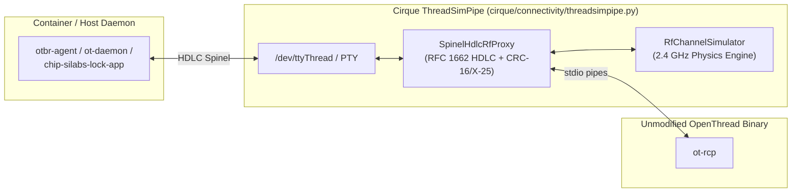

# Cirque 2.4 GHz Multi-Radio RF Channel & Coexistence Simulation Design

> [!IMPORTANT]
> **Related Design Documents**:
> - [Unified Virtual RF Architecture (`docs/VIRTUAL_RF_ARCHITECTURE.md`)](./VIRTUAL_RF_ARCHITECTURE.md)
> - [Virtual Bluetooth Design (`docs/VIRTUAL_BT_DESIGN.md`)](./VIRTUAL_BT_DESIGN.md)
> - [Virtual Wi-Fi Design (`docs/VIRTUAL_WIFI_DESIGN.md`)](./VIRTUAL_WIFI_DESIGN.md)

---

## 1. Overview & Motivation

By default, virtualized smart-home testbeds operate in an **idealized (`0%` loss, constant RSSI)** radio regime where every BLE advertisement, Wi-Fi L2 frame, and IEEE 802.15.4 Thread packet is delivered instantaneously with deterministic signal strength (`-38` to `-44 dBm`, `LQI = 255`, `PER = 0.0`). While effective for happy-path functional smoke tests, this ideal environment masks timing-sensitive protocol bugs, exchange-pool exhaustion, asymmetric link traps, and retransmission race conditions in upper-layer stacks such as Matter (`connectedhomeip`) and OpenThread.

`RfChannelSimulator` (`cirque/connectivity/rf_channel_simulator.py`) and `SpinelHdlcRfProxy` (`cirque/connectivity/threadsimpipe.py`) introduce a unified, literature-grounded **2.400–2.4835 GHz ISM Multi-Radio RF Channel & Coexistence Simulator** across all three virtual radios in Cirque—**Bluetooth Low Energy (BLE)**, **IEEE 802.11 (Wi-Fi)**, and **IEEE 802.15.4 (Thread)**—entirely within Cirque userspace and **with zero modifications to the OpenThread or Matter C++ codebases**.

---

## 2. 2.4 GHz Channel Model

Every packet traversing `LinkLayerHub` (BLE), `VirtualWiFiServer` (Wi-Fi), or `SpinelHdlcRfProxy` (Thread 802.15.4) is evaluated by one deterministic link budget plus duty-cycled interference in `RfChannelSimulator.evaluate_packet()`. The only random draws (from the seeded RNG) are the per-packet interferer on/off state and the per-packet drop.

### Step 1: Log-Distance Path Loss with Wall Attenuation

$$PL(d) = PL(d_0) + 10 \, n \, \log_{10}\!\left(\frac{\max(d, d_{\min})}{d_0}\right) + N_{\text{walls}} \, W$$

where $PL(d_0) = 20 \log_{10}(f_{\text{MHz}}) - 27.55$ is the Friis free-space reference path loss at $d_0 = 1.0\text{ m}$ (`~40.05 dB` at `2.44 GHz`), $n$ is the path-loss exponent, and $W$ is the per-wall attenuation (`dB`). The received power is $P_{\text{rx}} = P_{\text{tx}} - PL(d)$ (no shadowing or fading).

- **External References**:
  - T. S. Rappaport, *Wireless Communications: Principles and Practice*, 2nd ed., Prentice Hall, 2002, ch. 4.
  - ITU-R Recommendation P.1238-11, *"Propagation data and prediction methods for the planning of indoor radiocommunication systems and radio local area networks in the frequency range 300 MHz to 450 GHz,"* 2021.

### Step 2: Thermal Noise Floor and Spectral-Overlap Interference SINR

$$\text{SINR}_{\text{dB}} = P_{\text{rx,dBm}} - 10 \log_{10}\!\left(10^{N_{0,\text{dBm}}/10} + \sum_{k \in \text{on}} \alpha_{ik} \, I_{k,\text{mW}}\right)$$

where $\alpha_{ik} \in [0, 1]$ is the fractional power spectral density overlap (`spectral_overlap_factor()`) between victim channel $i$ and interferer $k$ across BLE (`2 MHz`), IEEE 802.15.4 Thread (`2 MHz`, channels `11..26` at $2405 + 5(c - 11)\text{ MHz}$), and IEEE 802.11 Wi-Fi (`20 MHz`, channels `1..13` at $2407 + 5c\text{ MHz}$). Each overlapping interferer is on for a packet with probability equal to its duty cycle.

- **External References**:
  - IEEE Std 802.15.2-2003, Clause 6 (Analytical Coexistence Model).

### Step 3: Logistic PER and LQI Mapping

- **Packet Error Rate (`per_from_sinr()`)**: one protocol-agnostic logistic curve, capped by `max_per_cap`:
  $$\text{PER} = \min\!\left(\text{max\_per\_cap}, \; \frac{1}{1 + e^{(\text{SINR}_{\text{dB}} - \text{SINR}_{50}) / s}}\right)$$
  with slope $s = 1.5\text{ dB}$ and per-protocol $\text{SINR}_{50}$ calibration constants (Thread `3 dB`, Wi-Fi `6 dB`, BLE `12 dB`).
- **IEEE 802.15.4 LQI (`0..255`) and OpenThread Link Quality (`0..3`)**:
  `compute_802154_lqi()` maps SINR linearly from `0 dB` (LQI `0`) to `30 dB` (LQI `255`); `compute_openthread_link_quality()` maps LQI and SINR margin to OpenThread `LQ In` $\in \{0, 1, 2, 3\}$.

---

## 3. Architecture: Zero-OpenThread-Change Interception via `SpinelHdlcRfProxy`

To simulate Thread 802.15.4 RF impairments **without modifying a single line of OpenThread C/C++ code**, Cirque intercepts the HDLC-framed Spinel stream between the host/container daemon (`otbr-agent`, `ot-daemon`, or `qemu-arm` Silabs Lock App) and the unmodified `ot-rcp` process inside `ThreadSimPipe` (`cirque/connectivity/threadsimpipe.py`).



### How `SpinelHdlcRfProxy` Rewrites Spinel Frames In-Flight

1. **Inbound RX Frames (`RCP -> Host`, `SPINEL_PROP_STREAM_RAW = 0x71`)**:
   - Unescapes the RFC 1662 HDLC frame (`0x7E` flag, `0x7D` escape, plus OpenThread POSIX `HdlcInterface::Write` special-escaped bytes `0x11`, `0x13`, `0xF8`).
   - Parses `PackRadioFrame` (`[psdu_len_lo, psdu_len_hi] + psdu + [rssi_int8, noise_floor_int8, flags(2B), phy_header(10B)]`).
   - Evaluates `RfChannelSimulator.evaluate_packet('thread', peer_id, node_id, frame_len_bytes=psdu_len)`.
   - If `sample.dropped` is `True` (and the frame is not an 802.15.4 Beacon `frame_type == 0` required for cold commissioning scan), drops the frame before it reaches `otbr-agent` / the end-device.
   - Otherwise, rewrites `rssi_int8 = sample.rssi_dbm`, `noise_floor_int8 = int(sample.noise_floor_dbm)`, and `lqi_uint8 = sample.lqi`, recomputes `CRC-16/X-25` (`poly=0x8408, init=0xFFFF, xorout=0xFFFF`), and re-encodes the HDLC frame.
2. **Inbound TX-Done ACK Metadata (`RCP -> Host`, `SPINEL_PROP_LAST_STATUS = 0x00`)**:
   - When an outbound data frame was marked as dropped by `RfChannelSimulator` (`_drop_next_tx_done`), rewrites `SPINEL_STATUS_OK (0x00)` to **`SPINEL_STATUS_NO_ACK (0x11)`** while preserving the `headerUpdated` boolean and the 5-byte `(keyIndex, frameCounter)` MAC security trailer appended by `ot-rcp`, causing the sender's OpenThread MAC layer to increment `TxRetry` / `TxErrNoAck` and perform genuine IEEE 802.15.4 CSMA/CA retransmissions (and any upper-layer retransmissions) without corrupting the auxiliary security frame counter!
   - When the ACK succeeds, rewrites the embedded ACK `PackRadioFrame` RSSI and LQI fields so `ot-ctl child table` and `ot-ctl neighbor table` reflect live link quality (`LQ In` $\in \{0, 1, 2, 3\}$).
3. **Ambient CCA Energy Queries (`RCP -> Host`, `SPINEL_PROP_PHY_RSSI = 0x26`)**:
   - Rewrites the 1-byte signed RSSI response to `ot-ctl rssi` and CSMA/CA Clear Channel Assessment using `RfChannelSimulator.sample_ambient_cca_rssi_dbm('thread')`.

---

## 4. Built-In RF Presets

Researchers can switch presets at any time via Python (`RfChannelSimulator.get_shared().apply_regime_preset(preset)`), Flask REST (`POST /rf_channel {"preset": "<name>"}`), or MCP (`cirque_inject_rf_fault`, recipe `rf_cochannel_interference`).

| Preset Name | Distance & Topology | Active 2.4 GHz Interferers | Typical Thread RSSI / SINR / Drop Rate | Purpose |
| :--- | :--- | :--- | :--- | :--- |
| **`ideal`** *(Default)* | `d = 1.5 m`, `n = 2.0`, `0` walls | None | `-36 dBm`, `SINR +59 dB`, `LQI 255`, `0%` drops (`max_per_cap = 0`) | Deterministic happy-path baseline. |
| **`regime_c_cochannel_interference`** | `d = 20 m`, `n = 3.4`, `0` walls, `N0 = -95 dBm` | Wi-Fi Ch 4 (`2427 MHz`, `+20 dBm`, `90%` on/off duty cycle) | `-76 dBm`; `SINR +19 dB` (off) / `-40 dB` (on); `~40%` drops (`max_per_cap = 0.45`) | Co-channel Wi-Fi collisions on Thread Ch 15, BLE Ch 38 and Wi-Fi Ch 6. BLE advertising on Ch 37 is not overlapped and sees only the longer link (`SINR +15 dB`, `~14%` drops). |

`regime_c` aliases: `regime_c`, `cochannel_interference`, `interference`. `ideal` aliases: `disabled`, `off`, `clean`.

### Custom Fine-Grained Researcher Configuration (`POST /rf_channel`)

Beyond the named presets, researchers can configure node positions, per-radio TX powers, wall counts, propagation constants, PRNG seeds, and interferers in a single JSON payload:

```json
{
  "preset": "regime_c_cochannel_interference",
  "seed": 2026,
  "config": {
    "path_loss_exp": 3.1,
    "wall_loss_db": 6.0,
    "noise_floor_dbm": -93.0,
    "max_per_cap": 0.45,
    "ble_channel": 38,
    "wifi_channel": 6,
    "thread_channel": 15
  },
  "nodes": [
    {"node_id": "tbr", "x_m": 0.0, "y_m": 0.0, "z_m": 1.0, "tx_power_thread_dbm": 8.0, "walls": 1},
    {"node_id": "sed", "x_m": 16.0, "y_m": 2.5, "z_m": 1.0, "tx_power_thread_dbm": 0.0, "walls": 2}
  ],
  "interferers": [
    {"interferer_id": "neighbor_ap", "protocol": "wifi", "channel": 4, "tx_power_dbm": 18.0, "duty_cycle": 0.65, "x_m": 2.0, "y_m": 1.0, "z_m": 1.0}
  ]
}
```

---

## 5. Protocol-Level Race Conditions Exposed by RF Presets

A central question for protocol engineers is why replace the default `ideal` preset with `regime_c_cochannel_interference`.

Under `ideal` (`0%` packet loss, `0.0 dB` RSSI variance), frames succeed on the first transmission, hiding timing and concurrency races. Under non-ideal regimes, dropped frames trigger retries, backoffs, and timeouts, stretching exchange lifetimes and exposing state-machine race conditions.

For Matter (`connectedhomeip`) protocol-level tests that exercise packet loss, see `docs/testing/cirque_rf_lossy_link.md` in the `connectedhomeip` repository.

---

## 6. Verification Commands

```bash
# 1. Run the hermetic Cirque RF Channel Simulator & SpinelHdlcRfProxy unit test suite (10 tests):
PYTHONPATH=. python3 cirque/connectivity/test_rf_channel_simulator.py -v

# 2. Run the end-to-end Android Emulator + Thread Border Router + Silabs Lock App RF RSSI test:
python3 src/test_driver/linux-cirque/AndroidBleThreadSilabsLockRfRssiTest.py
```
